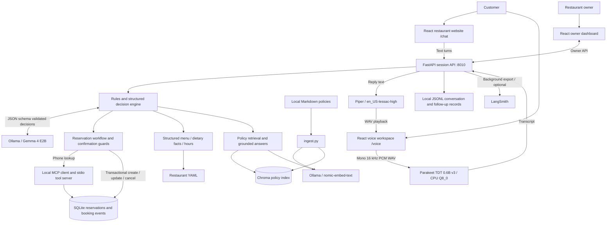

# Algo Garden

A local AI receptionist for an Indo-Italian restaurant: a restaurant website with menu and chat, a browser voice agent, and an owner workspace for reservations and follow-ups. Built as a Week 4 **Mastering AI Agents** project.

Chat and voice share the same reservation engine. Customers can book, look up reservations by phone number, update or cancel them, ask menu and policy questions, and leave optional **good / bad** feedback.

## Architecture



Vite serves the UI on **5173** and proxies `/api` to FastAPI on **8010**. Ollama normally listens on **11434**. The Parakeet adapter starts its own private loopback process when needed; you do not start a separate ASR server manually.

### Technologies and responsibilities

| Component | Technology | Responsibility |
|---|---|---|
| Customer and owner UI | React 19, Vite 7, CSS, Lucide icons | Restaurant menu, floating chat, voice controls, calendar/table planning and audit summaries |
| API and session management | Python 3.12+, FastAPI, Uvicorn, Pydantic | Session lifecycle, validated HTTP contracts, admission queue and owner actions |
| Routing and extraction | Python rules, Ollama `gemma4:e2b-it-qat`, JSON Schema | Intent, explicitly supplied fields, confidence and brief decision summaries; deterministic paths skip generation where supported |
| Reservation tools | Python, MCP SDK over local stdio | Phone-based reservation lookup with reusable scoped connections |
| Durable reservations | SQLite, Python `sqlite3` | Atomic capacity/duplicate checks, versions, idempotency receipts and booking history |
| Speech recognition | NVIDIA Parakeet TDT 0.6B v3 Q8_0, NeMo-Speech.cpp 0.2.0 | Local CPU transcription of completed audio segments |
| Short survey recognition | faster-whisper `small` | Conditional acoustic second pass for short good/bad answers |
| Speech synthesis | Piper `en_US-lessac-high` | Local American English spoken replies |
| Audio capture | Browser MediaDevices/Web Audio; optional terminal sounddevice/Silero VAD | Microphone capture, endpoint detection and playback |
| Policy RAG | Chroma, Ollama `nomic-embed-text`, local Markdown | Restaurant-scoped retrieval and validated source-grounded policy answers |
| Business configuration | YAML, PyYAML, phonenumbers, zoneinfo/tzdata | Menu, allergens, USD prices, hours, phone normalization and restaurant-local dates |
| Owner audit and feedback | Local JSONL files | Conversation history, notes, resolve/reopen status and optional surveys |
| Observability | Local metrics and optional LangSmith | Stage timings and background, payload-minimized trace export |
| Verification | pytest, Node tests, generated-audio integration scripts | Workflow, confirmation, persistence and speech-service checks |

## What the application does

- Creates reservations after reading back the details and receiving confirmation.
- Looks up existing reservations by **phone number**; asks which one if multiple bookings match.
- Reads back updates/cancellations and asks for confirmation before writing. A menu question during confirmation does not authorize a change.
- Retains booking context across vegan, gluten-free and peanut questions. Dietary answers use recorded facts and do not promise unverified allergy safety.
- Resolves relative dates from the server's current restaurant-local date and checks opening hours.
- Checks overlapping seat/table capacity, duplicate customer slots and stale reservation versions inside SQLite write transactions.
- Shows owner reservation planning, daily utilization, channel colors and guest names, plus actionable follow-up summaries and notes.
- Supports app-only voice mute, separate caller/agent transcript colors and optional good/bad feedback.

The current restaurant configuration is **Saffron & Basil** (served by the Algo Garden AI receptionist), USD, `America/Chicago`, ten four-seat tables and 90-minute stays. Lunch is 11 am–3 pm, dinner 6–11 pm, and weekend brunch 7–10 am. A complete stay must fit within service hours.

## Run locally on Windows

The browser voice instructions below match the current **Windows x64 CPU** Parakeet adapter. Chat can run without installing voice dependencies. Allow several GB of disk space for models and dependencies; first startup and model downloads take longer than warm requests.

### 1. Prerequisites

Install Git, Python 3.12, [uv](https://docs.astral.sh/uv/getting-started/installation/), Node.js 22.12+ and [Ollama](https://ollama.com/download). Ensure Ollama is running. No hosted LLM API key is needed for local inference.

```powershell
git clone https://github.com/algoshank-pat/AlgoGarden.git
cd AlgoGarden
uv sync --python 3.12
ollama pull gemma4:e2b-it-qat
ollama pull nomic-embed-text
```

Commands below assume the project root unless they explicitly enter `dashboard`. `uv` creates `.venv` automatically; activation is unnecessary.

### 2. Configure the restaurant and index policies

Edit `restaurants/demo_restaurant.yaml` for the menu, allergens, contact details, hours, timezone and table layout. The real street address and contact number need configuration. Keep the existing restaurant `id` when renaming an established business so its reservations remain associated.

The retained `knowledge_id: malnad_mane` selects the sample policy folder; it is an internal identifier, not the current display name. Review the fictional policies before using them as real business rules.

```powershell
uv run python ingest.py --business malnad_mane
```

Run ingestion with the API stopped, and repeat it whenever policy documents change. The Chroma index is generated locally and is not included in Git. Missing or stale policy indexes lead to an uncertainty/staff response rather than an invented policy.

### 3. Start the API — terminal A

```powershell
uv run uvicorn chat_api:app --host 127.0.0.1 --port 8010
```

SQLite initializes automatically on first database use. A fresh clone starts without the original laptop's reservations, customer transcripts or downloaded models. Keep Uvicorn to **one process**: active sessions, scheduling and JSONL synchronization are process-local.

### 4. Start the UI — terminal B

```powershell
cd dashboard
npm ci
npm run dev
```

| Page | Local URL |
|---|---|
| Restaurant website and chat | http://127.0.0.1:5173/chat |
| Voice receptionist | http://127.0.0.1:5173/voice |
| Owner overview | http://127.0.0.1:5173/ |
| Conversations and follow-ups | http://127.0.0.1:5173/owner/conversations |
| Reservations and table planning | http://127.0.0.1:5173/owner/reservations?view=live |
| API documentation | http://127.0.0.1:8010/docs |

Open the floating chat button on the restaurant website. Try “Can I book a table for two next Saturday at half past eight?” Provide your phone number and name when asked, then check the readback before confirming. To change a booking, say “I'd like to update my reservation” and give its phone number; no reservation reference is required.

### 5. Install speech dependencies and models

Stop the API before installing voice dependencies, then run:

```powershell
uv sync --extra voice
uv run --extra voice python prepare_voice.py
```

`prepare_voice.py` downloads Piper **en_US-lessac-high** and faster-whisper **small**. It does **not** download Parakeet or its native runtime. Complete both downloads below before starting voice.

Download the Windows x64 CPU archive `nemo-speech-0.2.0-windows-x86_64-cpu.zip` from the [NeMo-Speech.cpp v0.2.0 release](https://github.com/NVIDIA/NeMo-Speech.cpp/releases/tag/v0.2.0). Extract it under `tools/nemo-speech-0.2.0/runtime` so this exact executable exists:

```text
tools/nemo-speech-0.2.0/runtime/nemo-speech-0.2.0-windows-x86_64-cpu/bin/nemo-speech.exe
```

Download the pinned Parakeet GGUF into the exact path expected by the adapter:

```powershell
$parakeetRevision = '541d1f99c6b0c3cd0b11a95167540bb8edefd82b'
$parakeetFolder = "models/nemotron/nvidia/parakeet-tdt-0.6b-v3/$parakeetRevision"
New-Item -ItemType Directory -Force -Path $parakeetFolder | Out-Null
$parakeetFile = "$parakeetFolder/parakeet-tdt-0.6b-v3.q8_0.gguf"
Invoke-WebRequest -Uri "https://huggingface.co/nvidia/parakeet-tdt-0.6b-v3/resolve/$parakeetRevision/parakeet-tdt-0.6b-v3.q8_0.gguf" -OutFile $parakeetFile
(Get-FileHash -Algorithm SHA256 -LiteralPath $parakeetFile).Hash
```

Expected model SHA-256:

```text
e3880d0aaaaf2c308ea2c35016b2b895c423eb3fda924c1b463d1c19b7f4d32e
```

The adapter verifies this checksum at startup. Review upstream runtime/model licenses when redistributing them. The `models/nemotron` folder name is retained from benchmarking; the active model in that path is **Parakeet**.

### 6. Start a browser voice call

Restart terminal A with voice dependencies enabled:

```powershell
uv run --extra voice uvicorn chat_api:app --host 127.0.0.1 --port 8010
```

Keep Vite running. Open `/voice`, select **Start call**, allow browser microphone access, and wait for dialing tones and the greeting. Speak when the agent is listening; a pause submits your answer automatically.

- **Mute** stops this agent from listening. It does not mute Teams or your system microphone, and you can still hear replies.
- **Unmute** continues the same conversation.
- **End call** stops capture and playback. It does not cancel a saved reservation.
- Caller and agent text use different colors; live previews are replaced by final transcripts.

The browser uses completed-segment speech recognition and turn-based replies, rather than full-duplex streaming. Speech during agent playback is ignored to reduce echo interruptions. Use headphones for the first hardware test. Local speech requests share a bounded audio service; finish a live call before running synthetic voice suites.

### Optional terminal microphone client

With the API running, open another terminal at the project root:

```powershell
uv run --extra voice python voice_agent.py --list-devices
uv run --extra voice python voice_agent.py --phone-region US --piper-model models/piper/en_US-lessac-high.onnx
```

Use `--input-device` and `--output-device` with IDs from your own device list if needed. Explicit US/high-voice arguments avoid the terminal launcher's older defaults. This client uses Silero VAD and sounddevice; the browser uses its own capture/endpoint logic.

## Optional LangSmith tracing

Set these in the same PowerShell terminal that starts the API:

```powershell
$env:LANGSMITH_TRACING = 'true'
$env:LANGSMITH_PROJECT = 'algo-garden'
$env:LANGSMITH_API_KEY = '<your-key>'
```

Then start Uvicorn normally. Keep real keys out of Git. `.env.example` documents settings; the application does **not** automatically load an `.env` file. Trace exports use a bounded background queue and omit raw conversation text and retrieved documents; local audits retain conversation data.

Other supported settings include `RECEPTIONIST_MODEL`, `OLLAMA_KEEP_ALIVE`, `OLLAMA_NUM_CTX`, `OLLAMA_NUM_PREDICT`, `RECEPTIONIST_TURN_WORKERS`, `RECEPTIONIST_QUEUE_LIMIT` and `RECEPTIONIST_QUEUE_WAIT_SECONDS`. Defaults favor local CPU operation: one active turn, six waiting turns, 2048 context tokens and 192 generated tokens. Different sessions can connect together, but default turn execution is serialized. Do not increase concurrency without measuring your hardware.

## Verification

From the project root:

```powershell
uv run --extra voice pytest tests/test_dietary_menu.py tests/test_customer_feedback.py tests/test_survey_recognition.py -q
uv run --extra voice python scripts/test-dietary-reservation-changes.py
```

The integration script requires the live API and speech models. It creates dedicated test reservations and checks chat/voice update and cancellation after dietary questions, including confirmation guards, then cancels remaining active fixtures. Review its report under `results/dietary-reservation-changes/` if a run fails. These workflows write real local test records; use a development database.

Build the frontend separately:

```powershell
cd dashboard
npm run build
```

The broader suite is available with `uv run --extra voice pytest tests -q`; not all historical fixtures have been migrated to the current US restaurant configuration. Do not interpret focused passes as a claim that the entire legacy suite passes. Generated-audio tests exercise actual local speech services, but do not verify physical microphones, speakers, room noise or human accents. No general latency guarantee is claimed.

## Repository guide

| Path | Purpose |
|---|---|
| `dashboard/src/` | Customer website/chat, voice workspace and owner UI |
| `chat_api.py`, `browser_voice.py` | Session, owner and browser speech endpoints |
| `receptionist.py`, `decision_engine.py`, `routing.py` | Shared conversation workflows and structured routing |
| `dietary_menu.py`, `information_requests.py` | Grounded dietary answers and safe information interruptions |
| `booking_db.py`, `reservation_mcp_client.py` | Transactional persistence and MCP lookup client |
| `restaurants/demo_restaurant.yaml` | Active business configuration |
| `businesses/*/docs/`, `ingest.py`, `knowledge.py` | Policy corpus, ingestion and retrieval |
| `voice/`, `voice_agent.py`, `prepare_voice.py` | Speech adapters, terminal client and model preparation |
| `observability.py` | Optional background LangSmith tracing |
| `tests/`, `scripts/` | Regression tests, evaluations and integration workflows |

## Data and prototype limits

Reservations and their events live in `reservations.sqlite3`; conversation audits, messages and owner follow-ups use local JSONL files. These records survive restarts, but active conversational sessions do not. Downloaded models, dependencies, generated results, recordings, databases and secrets are excluded from Git.

This is a **loopback-only prototype** with unauthenticated owner endpoints. Phone matching finds contact records; it does not verify identity. Table positions are suggested planning assignments, not physical check-in sensors or permanently assigned tables. SQLite protects reservation transactions, but JSONL conversation logs are not an atomic, tamper-proof audit system. Public hosting, authentication, verified caller identity, real telephone integration and multi-host operation need additional work.
